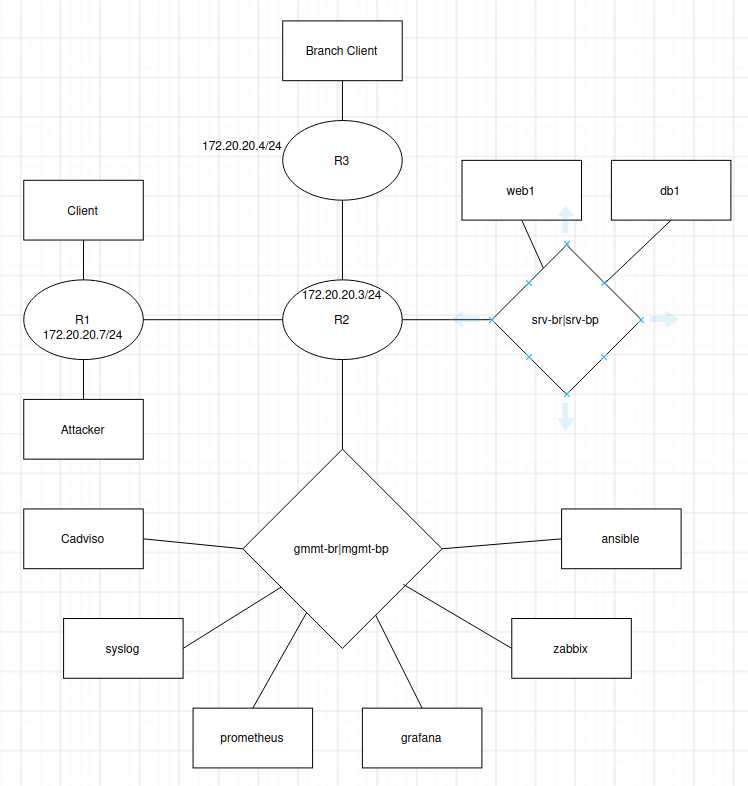

# 1. Johdanto

Tästä dokumentista selviää verkkoympäristön rakenne toiminta ja ip-suunnitelma. Dokumentista löytyy myös reitityksen analyysi.

# 2. Verkkokaavio

# 3. Laiteluottelo

| Laite | Tarkoitus |
|---------|---------|
| r1 | Yhdistää ulkoiset käyttäjät loppuun verkkoympäristöön. |
| r2 | Yhdistää verkkoalueet keskenään. |
| r3 | Sivutoimipisteen reititin. |
| client1 | Testikone asiakkaana |
| attacker | Testikone hyökääjänä |
| web1 | WWW-palvelin |
| db1 | Tietokantapalvelin |
| branch-client | Testikone sivutoimipisteen asiakkaana. |
| ansible | Automaatiohallintapalvelin. |
| prometheus | Valvontajärjestelmä. |
| grafana | Visualisointityökalu. |
| zabbix | Verkon ja palvelimien valvontajärjestelmä. |

# 4. IP-suunnitelma

| Verkko | Tarkoitus | Yhdyskäytävä |
|---------|---------|---------|
| 10.10.10.0/24 | Asiakasverkko | r1: 10.10.10.1 |
| 10.10.20.0/24 | Palvelinverkko | r2: 10.10.20.1 |
| 10.10.30.0/24 | Sivutoimipisteenverkko | r3: 10.10.30.1 |
| 10.10.99.0/24 | Hallintaverkko | r2: 10.10.99.1 |
| 10.255.12.0/30 | R1 & R2 välinen yhteys | Ei erillistä yhdyskäytävää. |
| 10.255.23.0/30 | R2 & R3 välinen yhteys | Ei erillistä yhdyskäytävää.|

| Verkko | Laitteet | ip-osoitteet |
|---------|---------|---------|
| 10.10.10.0/24 | r1, client1, attacker | r1: 10.10.10.1, client1: 10.10.10.101, attacker: 10.10.10.200 |
| 10.10.20.0/24 | r2, web1, db1 | r2: 10.10.20.1, web1:10.10.20.101, db1: 10.10.20.102 |
| 10.10.30.0/24 | r3, brach-client | r3: 10.10.30.1, brach-client 10.10.30.101 |
| 10.10.99.0/24 | r2, ansible, prometheus, grafana, zabbix, cadvisor, syslog | r2: 10.10.99.1 |
| 10.255.12.0/30 | r1,r2 | r1:10.255.12.1, r2:10.255.12.2 |
| 10.255.23.0/30 | r2,r3 | r2:10.255.23.1, r3:10.255.23.2 |

Asiakasverkko. Sisältää asiakkaan ja testausta varten attacker-koneen. Liike kulkee r1-reittimen kautta.
Palvelinverkko, Web1- ja db1-palvelimet sijaitsevat täällä. Yhdeistetty r2, jonka kautta liikenne kulkee muualle.
Sivutoimipisteen verkko, brach-clientti. Yhdistetty r3:een, joka yhdistyy r2:een.
Hallintaverkko, niin sanottu admin verkko. Sisältää kaikki hallinta ohjelmat.

# 5. Reitityksen analyysi

Asiakaskoneelta client1 on toimiva yhteys palvelinverkkoon 10.10.20.0/24 ja sivutoimipisteen verkkoon 10.10.30.0/24. Molemmat ping-testit onnistuivat ilman pakettihävikkiä.

Tracerouten perusteella liikenne sivutoimipisteeseen kulkee reittiä client1 → r1 → r2 → r3 → branch-client. Reitillä on kolme reititintä: r1, r2 ja r3. Reitittimet välittävät liikennettä verkkojen välillä OSPF-reitityksen avulla.

user@user-Z170-Gaming-K3:~/Documents/Verkonhallinta$ docker exec -it clab-hamk-verkonhallinta-golden-client1 bash
root@client1:/# ip addr
1: lo: <LOOPBACK,UP,LOWER_UP> mtu 65536 qdisc noqueue state UNKNOWN group default qlen 1000
    link/loopback 00:00:00:00:00:00 brd 00:00:00:00:00:00
    inet 127.0.0.1/8 scope host lo
       valid_lft forever preferred_lft forever
    inet6 ::1/128 scope host 
       valid_lft forever preferred_lft forever
31: eth0@if32: <BROADCAST,MULTICAST,UP,LOWER_UP> mtu 1500 qdisc noqueue state UP group default 
    link/ether 02:42:ac:14:14:0b brd ff:ff:ff:ff:ff:ff link-netnsid 0
    inet 172.20.20.11/24 brd 172.20.20.255 scope global eth0
       valid_lft forever preferred_lft forever
    inet6 fe80::42:acff:fe14:140b/64 scope link 
       valid_lft forever preferred_lft forever
38: eth1@if37: <BROADCAST,MULTICAST,UP,LOWER_UP> mtu 9500 qdisc noqueue state UP group default 
    link/ether aa:c1:ab:d6:9d:21 brd ff:ff:ff:ff:ff:ff link-netnsid 1
    altname clab-o-05031180f95d8850
    inet 10.10.10.101/24 scope global eth1
       valid_lft forever preferred_lft forever
    inet6 fe80::a8c1:abff:fed6:9d21/64 scope link 
       valid_lft forever preferred_lft forever
root@client1:/# ip route
default via 10.10.10.1 dev eth1 
10.10.10.0/24 dev eth1 proto kernel scope link src 10.10.10.101 
172.20.20.0/24 dev eth0 proto kernel scope link src 172.20.20.11 
root@client1:/# ping -c 4 10.10.20.101
PING 10.10.20.101 (10.10.20.101) 56(84) bytes of data.
64 bytes from 10.10.20.101: icmp_seq=1 ttl=62 time=0.195 ms
64 bytes from 10.10.20.101: icmp_seq=2 ttl=62 time=0.130 ms
64 bytes from 10.10.20.101: icmp_seq=3 ttl=62 time=0.136 ms
64 bytes from 10.10.20.101: icmp_seq=4 ttl=62 time=0.133 ms

--- 10.10.20.101 ping statistics ---
4 packets transmitted, 4 received, 0% packet loss, time 3096ms
rtt min/avg/max/mdev = 0.130/0.148/0.195/0.026 ms
root@client1:/# ping -c 4 10.10.30.101
PING 10.10.30.101 (10.10.30.101) 56(84) bytes of data.
64 bytes from 10.10.30.101: icmp_seq=1 ttl=61 time=0.456 ms
64 bytes from 10.10.30.101: icmp_seq=2 ttl=61 time=0.057 ms
64 bytes from 10.10.30.101: icmp_seq=3 ttl=61 time=0.128 ms
64 bytes from 10.10.30.101: icmp_seq=4 ttl=61 time=0.138 ms

--- 10.10.30.101 ping statistics ---
4 packets transmitted, 4 received, 0% packet loss, time 3111ms
rtt min/avg/max/mdev = 0.057/0.194/0.456/0.154 ms
root@client1:/# traceroute 10.10.30.101
traceroute to 10.10.30.101 (10.10.30.101), 30 hops max, 60 byte packets
 1  10.10.10.1 (10.10.10.1)  0.091 ms  0.039 ms  0.032 ms
 2  10.255.12.2 (10.255.12.2)  0.060 ms  0.048 ms  0.044 ms
 3  10.255.23.2 (10.255.23.2)  0.072 ms  0.061 ms  0.059 ms
 4  10.10.30.101 (10.10.30.101)  0.090 ms  0.078 ms  0.075 ms

# 6. Yhteenveto

En osaa sanoa mitään yhteen vedossa. Sorgens.

# 7. Tekoälyn käyttö
Tehtävän suorittamisessa on käytetty huomattavasti tekoälyä apuna. Opiskelijan ymmärrys ja mielenkiinot verkkolaitteita kohtaan on huomattavan suppeaa. Topologiakartan piirto on suoritettu ilman tekoälyä. Reitittimien tarkoitus aukesi vasta containerlabin oman verkkokaavion nähtyä.

En välitä arvosanasta. Haluan vain tämän pakollisen kurssin läpi, jotta voin keskittyä aiheisiin, jotka minua oikeasti kiinnostavat.