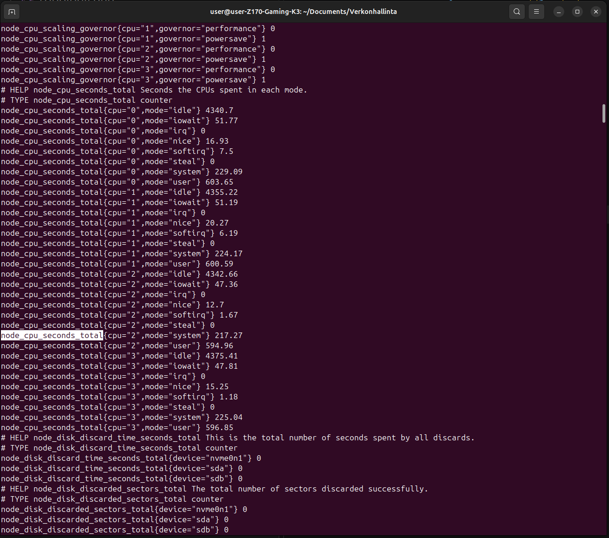
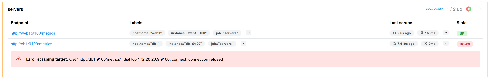

# 1. Johdanto

Tällä viikolla harjoitellaan seurantaohjelmistojen käyttöä. Ohjelmien tarkoituksena on seurata muutoksia ympäristössä kuten kovalevyn käyttöä tai verkkoliikenteen määrää.

# 2. Node Exporterin käyttöönotto

Asennetaan tarvittavat ohjelmat
    
    apt install wget tar -y

Asennetaan uusin Node Exporter versio. Tällä hetkellä 1.12.1

    wget https://github.com/prometheus/node_exporter/releases/latest/download/node_exporter-1.12.1.linux-amd64.tar.gz

Puretaan paketti

    tar xvf node_exporter-*.linux-amd64.tar.gz

Poistetaan vanha paketti

    rm node_exporter-*.linux-amd64.tar.gz

Siirrytään hakemistoon ja käynnistetään Node exporter

    cd node_exporter-*
    ./node_exporter

Tarkistetaan toiminta, ennen kun aloitetaan käyttö.

Avataan uusi terminaali.

    docker exec -it clab-hamk-verkonhallinta-golden-web1 bash
    curl http://localhost:9100/metrics

Ilmestyy monta riviä tekstiä. 
Tekstin seasta voidaan hakea seuraavia oleellisia tietoja

    node_cpu_seconds_total
    node_memory_MemTotal_bytes
    node_filesystem_size_bytes

Alla olevassa kuvassa näkyy listaus cpu käynnissä olo ajasta.

# 3. Prometheus

Havoinnot: Aika paljon punaista virheilmoitusta samalla sivulla. Jos kyseiset kontit käynnistäisi, niin saattaisivat olla vähemmän punaisia.

# 4. Dashboard

Kuvakaappaus koko dashboardista.

# 5. Kuormitustesti

Mittareiden käyttäytyminen kuormituksen aikana.

Kuormitustestin aikana mittarit käyttäytyivät kuten oletinkin. Levynkuormituskomennen aikana levyn käyttö kasvoi, CPU-rasitustestin aikana cpu:n ja muistin käyttö kasvoi. Verkkoliikenteessä näkyi muutoksia, mutta en keskittynyt siihen, että kumman komennon aikana muutokset tapahtuivat.

# 6. SNMP vs Prometheus

SNPM:llä tarkkaillaa tietyn laitteen liikennettä ja toimintaa. Prometheusta käytetään yleisempään tarkkailuun. Molemmat ovat tärkeä osa verkonhallintaa.

# 7. Yhteenveto

Mitä opit harjoituksesta?

Kivoja mittareita. En halua opiskella verkonhallintaa.